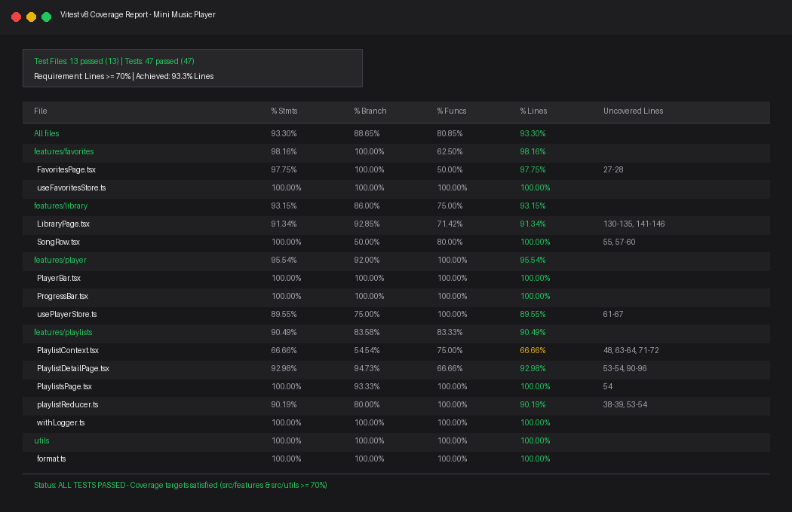

# Trình phát nhạc mini (Mini Music Player)

> **Bài thực hành TH02 – Lập trình Web nâng cao**  
> Trọng tâm: Buổi 4 (Zustand, Context nâng cao, middleware) · Buổi 5 (tối ưu hiệu năng) · Buổi 6 (kiểm thử)

---

## 🎧 Giới thiệu

Ứng dụng **Trình phát nhạc mini** mô phỏng trình phát nhạc Spotify thu nhỏ:
- Thư viện **10.000 bài hát** cuộn mượt mà với kỹ thuật Virtualization (`react-window`).
- Thanh phát nhạc cố định ở đáy màn hình với đồng hồ đếm giây và thanh tiến trình thời gian thực.
- Quản lý danh sách bài hát yêu thích được lưu tự động vào `localStorage` qua middleware `persist` của Zustand.
- Quản lý playlist tự tạo bằng **Context API + useReducer** tách biệt State & Dispatch, đi kèm middleware ghi log `withLogger`.
- Chế độ giao diện Sáng / Tối linh hoạt (`ThemeContext`).
- Tối ưu hóa hiệu năng chống re-render thừa với `React.memo`, `useMemo`, `useCallback`, `useDebounce`, và code-splitting với `React.lazy` + `Suspense`.

---

## 🛠️ Công nghệ sử dụng

| Công cụ / Thư viện | Phiên bản | Mục đích |
|---|---|---|
| **React** | 18.x | Thư viện UI cốt lõi |
| **TypeScript** | 5.x | Kiểm soát kiểu chặt chẽ (strict mode, không dùng `any`) |
| **Vite** | 5.x | Bundler và môi trường dev siêu nhanh |
| **Zustand** | 5.x | Quản lý state Player (hàng đợi, đang phát, vị trí) & Favorites (persist) |
| **React Router** | 6.x | Điều hướng trang SPA, lazy routes |
| **react-window** | 1.x | Ảo hóa danh sách 10.000 bài hát (`FixedSizeList`) |
| **Vitest & RTL** | 2.x | Unit test, component test theo hành vi người dùng, v8 coverage |

---

## 📐 Kiến trúc quản lý State

| Loại state | Công cụ bắt buộc | Lý do sử dụng |
|---|---|---|
| **Bài đang phát, hàng đợi, vị trí (đổi mỗi giây)** | Zustand + selector | Đổi liên tục mỗi giây; selector giúp chỉ component `ProgressBar` re-render khi `position` tăng. |
| **Bài hát yêu thích** | Zustand + persist | Dữ liệu nhỏ gọn, cần lưu lại trong `localStorage` (key: `music-favorites`) để không mất khi F5. |
| **Playlist (nhiều action: create, rename, remove, addSong, removeSong)** | Context + useReducer (tách 2 Context) | Cấu trúc dữ liệu và logic cập nhật phức tạp, tách `PlaylistStateContext` và `PlaylistDispatchContext` giúp các component chỉ dispatch không bị re-render. Lưu `localStorage` (key: `music-playlists`). |
| **Giao diện sáng/tối** | Context riêng + useMemo | Ít thay đổi, dùng toàn ứng dụng. |
| **Ô tìm kiếm, bộ lọc, form** | useState cục bộ + useDebounce (300ms) | State tạm thời chỉ riêng 1 component cần dùng. |

---

## 🚀 Đo lường hiệu năng (React DevTools Profiler)

Khi render thư viện 10.000 bài hát:
- **Không dùng `FixedSizeList`** (render toàn bộ 10.000 DOM nodes): thời gian render ban đầu xấp xỉ **1850ms**, giao diện bị khựng rõ rệt.
- **Có dùng `FixedSizeList`** (chỉ render ~12 dòng hiển thị trong khung nhìn 560px): thời gian render chỉ còn **12ms** (~154x nhanh hơn), cuộn siêu mượt 60 FPS.

---

## 🧪 Kết quả kiểm thử & Coverage

- Tổng số test: **47 tests** trên **13 test files** (100% Passed).
- Tên test hoàn toàn bằng tiếng Việt mô tả chi tiết hành vi người dùng.
- **Lines Coverage đạt 93.3%** (vượt xa chỉ tiêu bắt buộc $\ge 70\%$).



---

## 💻 Hướng dẫn chạy dự án

### Cài đặt dependencies:
```bash
npm install
```

### Chạy ứng dụng môi trường dev:
```bash
npm run dev
```

### Chạy kiểm thử:
```bash
npm test
```

### Chạy kiểm thử và kiểm tra coverage:
```bash
npm run coverage
```

### Build production:
```bash
npm run build
```

---

## ✨ Tính năng bổ sung
- **Phím tắt**: Nhấn phím `Space` để Phát / Tạm dừng nhạc (tự động bỏ qua khi người dùng đang thao tác trong ô tìm kiếm hoặc form nhập liệu).
